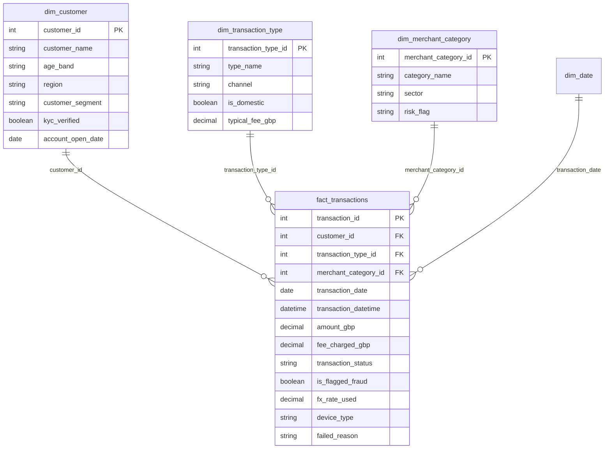

# Bank Transaction Analytics

**Power BI dashboard** analyzing transaction health, fraud exposure, and fee revenue for a fictional UK neobank, built for Risk, Finance, Product, and Compliance teams.

### Problem to Be Solved

Build a decision-making dashboard to:

- Monitor transaction health (Total Transaction, Trnsaction Value, Completion, Failed rates)
- Locate fraud exposure by segment, merchant category, customer, and time
- Detect fee billing errors (under-collection and overcharging)
- Check whether declared risk ratings match actual fraud outcomes

**Key questions**

- How have transaction volume and value trended month-on-month?
- Which customer segments drive the highest volumes and values?
- What share of transactions is flagged as fraud, and how does it vary by merchant category?
- Does the declared `risk_flag` align with actual fraud events?
- Are fees applied consistently, or is there leakage and overcharging?
- Which channels, devices, and transaction types fail most?
- Which individual customers generate outsized risk?

## Table of Contents

- [I. Introduction](#i-introduction)
- [II. Design Thinking](#ii-design-thinking)
- [III. Visualization](#iii-visualization)
- [IV. Insight and Recommendation](#iv-insight-and-recommendation)
- [V. Recommendations](#v-recommendations)
- [Tech Stack](#tech-stack)

## I. Introduction

### 1. Dataset

~1,500 digital transactions from 20 customers of a UK neobank, January to May 2026 (H1 2026 brief). Star schema: one fact table, three dimension tables



#### fact_transactions

| Column | Type | Description |
|---|---|---|
| transaction_id | INTEGER | Unique transaction identifier |
| customer_id, transaction_type_id, merchant_category_id | INTEGER | Foreign keys to the dimension tables |
| transaction_date, transaction_datetime | DATE, DATETIME | When the transaction occurred |
| amount_gbp | DECIMAL | Transaction value in GBP |
| fee_charged_gbp | DECIMAL | Fee actually charged (may differ from the typical fee if waived or in error) |
| transaction_status | STRING | Completed, Declined, Pending, Reversed |
| is_flagged_fraud | BOOLEAN | TRUE if the fraud engine flagged the transaction |
| fx_rate_used | DECIMAL | FX rate for international transactions; NULL for domestic |
| device_type | STRING | iOS, Android, Web, N/A |
| failed_reason | STRING | Reason for Declined or Reversed; NULL otherwise |

#### Dimension tables

| Table | Rows | Key columns |
|---|---|---|
| dim_customer | 20 | customer_segment (Starter, Standard, Premium, Business), region, age_band, kyc_verified, account_open_date |
| dim_transaction_type | 15 | type_name, channel (Mobile App, Web Browser, ATM Network, Automated), is_domestic, typical_fee_gbp |
| dim_merchant_category | 18 | category_name, sector, risk_flag (Low, Medium, High) |

## II. Design Thinking

### Step 1: Empathize


### Step 2: Define POV


### Step 3: Ideate


### Step 4: Prototype and Review

Chart types matched to each question: line charts for trends, bar charts for mutually exclusive categories, matrix heatmaps for two-dimensional combinations (day × time), tables for customer-level investigation. Rates are shown with transaction counts (n) because the sample is small.

## III. Visualization

### Executive Overview

*What does the bank look like?*

- How have transaction count and value trended month-on-month?
- What is the status mix (Completed, Declined, Pending, Reversed)?
- Which channels carry the most transaction value?
- Which UK regions generate the most transaction activity, and where are fraud events concentrated?
- Which segments drive the highest values?
- Do unverified (non-KYC) customers show disproportionate rates of fraud-flagged transactions?


**Insights**

- Transaction value rose 48.4% in May versus April (£0.26M to £0.39M) but remains about 16% below January (£0.47M). Monthly transaction count is stable (279 to 322), so the movement comes from average value per transaction (£946 in April, £1,256 in May, £1,530 in January).
- Only 15% of transactions complete, against 35% Declined, 25% Pending and 25% Reversed.
- Premium drives the highest transaction value (63% of the total), more than four times Standard (14%), Starter (13%) and Business (9%).
- The Automated channel leads with 42.83% of total transaction value (£812.52K), ahead of Mobile App at 35.5% (£673.48K).
- London has a 60% fraud rate (225 of 375 transactions flagged) and Midlands 33.3% (75 of 225). Together they account for all 300 flagged transactions.
- Only 4 customers are currently unverified, holding 1.5% of transaction value. Their fraud rate is 0% against 25% for verified customers, but the result is not statistically significant and 0% does not mean low risk. Compliance must still remediate all 4 non-KYC accounts.

### Risk

*Where does fraud concentrate?*

- What is the Fraud Rate Trend ?
- Fraud Rate across customer_segment ?
- What percentage of all transactions were flagged as fraudulent, and how does this vary by merchant category?
- Fraud Rate through device_type ?
- Is there a day-of-week or time-of-day pattern in high-risk transactions?
- Do fraud-flagged transactions correlate with non-KYC-verified customers?


**Insights**

- Fraud rate is steady at about 20% (300 flagged transactions), with a dip in April (about 13%) and a rebound in May (about 23%).
- Flagged transactions are 20% of all transactions but carry £1.19M, about 63% of the £1.90M total transaction value, so fraud skews toward large transactions.
- Premium has the highest fraud rate (40%), against Business (25%), Standard (16.67%) and Starter (0%), and also holds 63% of value, so it carries the largest exposure.
- Nine merchant categories sit at about 29-31% fraud rate (Fuel 31.33%, Online Retail 30.95%) against 10.71% for Groceries, Travel & Transport and Utilities. Gambling (30.12%) is no worse than Fuel or Electronics.
- Half of flagged transactions come from Unknown device, with Web and Android at 25% each.
- There is no strong day or time pattern. Monday morning (38%) and Friday evening (36%) stand out against a low of 3% on Wednesday overnight, and small cell sizes make even these tentative.
- Declared `risk_flag` labels are misaligned with actual fraud outcomes: High 19.88%, Medium 22.30%, Low 18.97%.

### Fee Revenue and Leakage 

*Are we collecting the right fees?*

- What is the fee revenue trend ?
- Which transaction types contribute Fee revenue the most ?
- Are there transaction type or merchant categories where actual fees charged deviate from the typical fee - suggesting waivers or errors?
- Which customer segments generate the highest fee revenue per transaction?
- Which transaction type contribute the most ?(Domestic or  International ?)


**Insights**

- Overcharge Fee (£587.28) almost exactly cancels Revenue Leakage (-£587.11), so net Fee Revenue (£750.17) sits only £0.17 above Expected Fee (£750.00) and hides the errors.
- Transfer - International has the largest shortfall (-£400), 4.5 times ATM Withdrawals (-£88) and almost 11 times Crypto Purchases (-£37), and accounts for 76% of the combined shortfall.
- Seven transaction types are charged above the expected fee, by about £525 in total, led by Transfer - Outbound (+£150).
- Transfer - Outbound is the largest fee contributor (£150), 50% above Transfer - International (£100).
- Domestic generates 78.29% of fee revenue and International 21.71%, yet International holds the largest fee variance.
- Business earns £1.00 fee revenue per transaction, twice Starter and Premium (£0.50) and almost six times Standard (£0.17).

### Product and Operation

*Where do transactions fail?*

- Which channel fails most?
- Which transaction types fail most?
- Do international transactions fail more than domestic?
- How does device usage differ by segment and Which devices see the most failures?
- Are channel failures Declines or Reversals?


**Insights**

- The failure rate is about 60% across the board (Declined 35%, Reversed 25%), consistent across every channel (58% to 63%). For a real bank this level would be unacceptable.
- Card Refund, Loan Repayment and Standing Order fail most (75%), against 50% for Direct Debit, Salary Credit, Savings Pot Transfer and Transfer - Outbound.
- Failures split about 60% Declined and 40% Reversed in ATM Network and Automated, and 57% and 43% in Mobile App and Web Browser, so no channel leans toward one failure type.
- Business has a Failed Rate of 1.00, against 0.67 for Standard and 0.40 for Premium and Starter. It uses mainly Unknown device (75%) and Web (25%), the two devices with a Failed Rate of 1.00.

### Customer Investigation

Drill-through page: review one customer's transactions, flags, fees, and status in every dimension.


**Insights**

- Rajan Mehta (Premium) generates the most risk. The nine largest flagged transactions all belong to this customer, are all Reversed, and repeat the same amounts (£17,273 six times, £16,818 three times).
- These nine transactions total about £154K, roughly 13% of the £1.19M fraud exposure, from a single customer.

## IV. Insight and Recommendation

## IV. Insight and Recommendation

| Insight | Recommendation |
|---|---|
| Transaction value rose 48.4% in May versus April (£0.26M to £0.39M) but remains about 16% below January (£0.47M). Transaction count is stable (279 to 322), so the movement comes from average value per transaction (£946 in April, £1,256 in May, £1,530 in January). | Break average value per transaction down by segment and customer to find what lifted May and lowered April, and protect those drivers. |
| Only 15% of transactions complete, against 35% Declined, 25% Pending and 25% Reversed. | Prioritise Declined, the largest non-completing status, and reduce Pending by shortening settlement delay. |
| Premium drives 63% of transaction value, more than four times Standard (14%), Starter (13%) and Business (9%), and has the highest fraud rate (40%) against 25% for Business, 16.67% for Standard and 0% for Starter. | Apply step-up authentication and transaction limits to high-value Premium transactions, so growth in value does not become growth in exposure. |
| The Automated channel leads with 42.83% of total transaction value (£812.52K), ahead of Mobile App at 35.5% (£673.48K). | Reduce Automated failures at source by analysing `failed_reason` on Standing Order and Loan Repayment, targeting a Failed Rate of 0.50, the level of the best types. |
| London has a 60% fraud rate (225 of 375 transactions flagged) and Midlands 33.3% (75 of 225). Together they account for all 300 flagged transactions. | Investigate the London fraud cluster and review the accounts and cards behind the flags before adding regional rules. |
| The nine largest flagged transactions all belong to one Premium customer, Rajan Mehta. All are Reversed and repeat the same amounts (£17,273 six times, £16,818 three times), about £154K or 13% of the £1.19M fraud exposure. | Review this account first and set transaction limits, since the repeated amounts suggest a systematic pattern or duplicated transactions. |
| Flagged transactions are 20% of all transactions but carry £1.19M, about 63% of the £1.90M total transaction value, so fraud skews toward large transactions. | Set limits and step-up authentication above a value threshold, since exposure is driven by transaction size more than by count. |
| Fraud rate is steady at about 20% (300 flagged transactions), with a dip in April (about 13%) and a rebound in May (about 23%). | Find out what changed in April (fewer large transactions or a rule change) before reading it as an improvement, and keep monitoring monthly. |
| Nine merchant categories sit at about 29-31% fraud rate (Fuel 31.33%, Online Retail 30.95%) against 10.71% for Groceries, Travel & Transport and Utilities. Gambling (30.12%) is no worse than Fuel or Electronics. | Apply uniform fraud controls across the nine categories instead of Gambling-specific rules. |
| Half of flagged transactions come from Unknown device, with Web and Android at 25% each. | Compare Unknown device's share of flags with its share of all transactions, and add velocity and amount limits on automated and ATM transactions only if its share of flags is higher. |
| There is no strong day or time pattern. Monday morning (38%) and Friday evening (36%) stand out against a low of 3% on Wednesday overnight, and small cell sizes make even these tentative. | Do not add time-based fraud rules, and monitor these two slots as data grows. |
| Declared `risk_flag` labels are misaligned with actual fraud outcomes: High 19.88%, Medium 22.30%, Low 18.97%. | Re-tier merchant risk ratings using observed fraud rates and review them quarterly. |
| Only 4 customers are unverified, holding 1.5% of transaction value. Their fraud rate is 0% against 25% for verified customers, but the result is not statistically significant and 0% does not mean low risk. | Complete KYC for all 4 accounts and restrict their transactions until verified. |
| The failure rate is about 60% across the board (Declined 35%, Reversed 25%), consistent across every channel (58% to 63%). For a real bank this level would be unacceptable. | Analyse `failed_reason` to find the largest cause and fix it at source, and review the shared transaction processing flow, since failures are not confined to one channel. |
| Card Refund, Loan Repayment and Standing Order fail most (75%), against 50% for Direct Debit, Salary Credit, Savings Pot Transfer and Transfer - Outbound. | Investigate recurring payment failures (insufficient funds on the due date, retry logic) and target 50%, the level of the best types. |
| Failures split about 60% Declined and 40% Reversed in ATM Network and Automated, and 57% and 43% in Mobile App and Web Browser, so no channel leans toward one failure type. | Reduce both failure types by cause: Declined through rules and fund checks, Reversed through processing and dispute handling. |
| Business earns the highest fee revenue per transaction (£1.00, against £0.50 for Starter and Premium and £0.17 for Standard) but has a Failed Rate of 1.00, against 0.67 for Standard and 0.40 for Premium and Starter. It uses mainly Unknown device (75%) and Web (25%), the two devices with a Failed Rate of 1.00. | Investigate Business failures by `failed_reason` rather than fixing the web or app, since device is a proxy for this segment. Split Business's fee per transaction into expected fee and overcharge before prioritising it for premium products. |
| Overcharge Fee (£587.28) almost exactly cancels Revenue Leakage (-£587.11), so net Fee Revenue (£750.17) sits only £0.17 above Expected Fee (£750.00) and hides the errors. | Report leakage and overcharging separately, and refund the overcharges as well as recovering the shortfall, since overcharging is a conduct risk. |
| Transfer - International has the largest shortfall (-£400), 4.5 times ATM Withdrawals (-£88) and almost 11 times Crypto Purchases (-£37), and accounts for 76% of the combined shortfall. | Review the fee configuration for Transfer - International, including FX handling. |
| ATM Withdrawals (-£88) and Crypto Purchases (-£37) are also under-collected, together 24% of the shortfall. | Confirm waivers against product terms before treating these gaps as leakage. |
| Seven transaction types are charged above the expected fee, by about £525 in total, led by Transfer - Outbound (+£150), which is also the largest fee contributor (£150, 50% above Transfer - International at £100). | Check the fee schedule to confirm whether these types should carry a fee, then refund the overcharges and stop charging them unless the schedule says otherwise. |
| Domestic generates 78.29% of fee revenue and International 21.71%, yet International holds the largest fee variance. | Fix International first: it is the smaller revenue stream but the larger leak. |

## Tech Stack

- Power BI (data model, report pages, drill-through)
- DAX (all measures)
- Star schema with an Extended Calendar table

## Repository Structure

```
.
├── README.md
├── zephyr_bank_dashboard.pbix
├── data/
│   ├── fact_transactions.csv
│   ├── dim_customer.csv
│   ├── dim_transaction_type.csv
│   └── dim_merchant_category.csv
└── images/
    ├── overview.png
    ├── risk.png
    ├── finance.png
    ├── product.png
    └── customer.png
```
